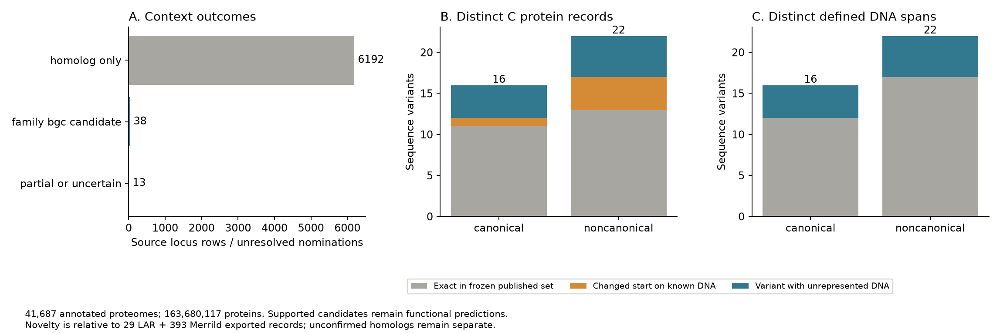
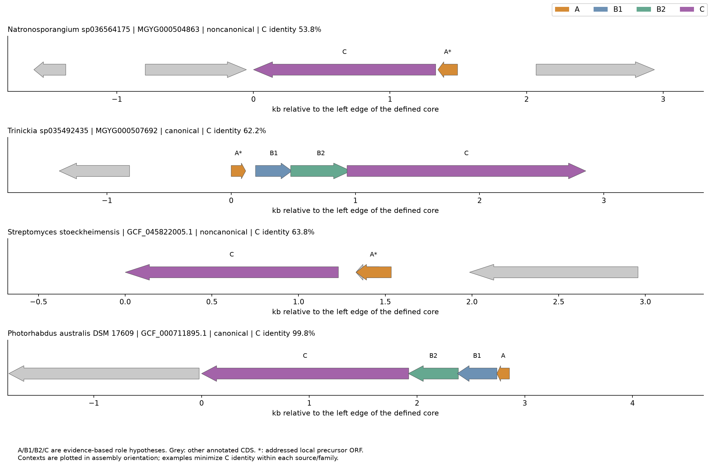

# Поиск и разнообразие лариоцидиноподобных систем: завершённый видовой этап

13.10.2026. Поиск и адресная проверка окружения завершены на ITMO через Slurm. Основной результат — **38 обоснованных кандидатов BGC: 16 канонических и 22 неканонических**. Девять содержат отличающиеся C и ДНК-ядра, отсутствующие в фиксированном наборе опубликованных выгрузок; семь из них происходят из почвенных MAG. Это предсказания биосинтетических систем, а не экспериментально установленные новые антибиотики.

Общая исходная база и её аудит описаны в [отчёте 12 октября](2026-10-12-diversity-redesign.md). Здесь приведён новый результат; прежний анализ Maize Rhizosphere и HGT сохраняют свои выборки, методы и выводы.

## Поиск и разнообразие

### Вопрос и выбор данных

Добавляет ли широкий поиск по аннотированным сборкам варианты последовательностей, архитектур и носителей относительно проверенного литературного набора? Операционная H0: обоснованные BGC не добавляют вариантов последовательностей/архитектур; H1: добавляют хотя бы один. Это описательное сопоставление каталогов, без статистического p-value. Дополнительный носитель известного варианта учитывается отдельно.

Один каталог Maize Rhizosphere отвечает на ограниченный вопрос о своей выборке и недостаточен для широкого исследования разнообразия. Для первого видового этапа выбраны **22 840 актуальных аннотированных бактериальных RefSeq reference-сборок** и **18 847 бактериальных species representatives MGnify Soil v1.0**, с completeness ≥50% и contamination <10%. Среди Soil записаны 18 659 MAG и 188 Isolate; культуры включены. Выбор представительных сборок ограничивает штаммовую избыточность и объём обработки, а Soil дополняет RefSeq экологически релевантными MAG. При этом reference-набор не охватывает все неклассифицированные виды и внутривидовые дополнительные гены.

Обработаны все **41 687 протеомов / 163 680 117 аннотированных белков**, около 41,5 GiB исходных протеомов. Три совпадения исходного GCA между источниками не позволяют считать все строки независимыми геномами. Для положительных кандидатов дополнительно сравнивались BioSample и хеши полных наборов контигов с нормализацией ориентации. Основные 38 локусов имеют 38 разных BioSample и 38 разных хешей сборок: повторных представлений одной сборки среди них не выявлено. Таксономические названия NCBI и GTDB сохранены с указанием источника; 38 разных отображаемых названий не интерпретируются как согласованная оценка числа видов.

Литературный знаменатель — **29 LAR + 393 записи из выгрузки Merrild**, всего 422 записи, включая повторные представления; это не 422 независимых или экспериментально проверенных BGC. Сравнивались белки C, предшественники, конкретные ДНК-участки и доступные contig/WGS/strain-поля. Сведения о [gelatinamin, 2026](https://chemistry-europe.onlinelibrary.wiley.com/doi/full/10.1002/cbic.70378) уточняют биологическую интерпретацию, но не заменяют этот фиксированный набор последовательностей. Июльский [препринт о follower-предшественниках](https://doi.org/10.64898/2026.07.03.736388) учтён по первичным API-метаданным и аннотации; полный набор его последовательностей не сопоставлен. Поэтому ниже «добавилось» означает добавление к указанным выгрузкам, а не приоритет открытия во всей литературе.

### Конкретный метод

Параметры зафиксированы в [diversity_protocol.json](../config/diversity_protocol.json) до итоговой курации. Основной путь один: аннотированные белки сборок → номинация двумя существующими HMM → адресное окружение C → оценка согласованности C, предшественника и архитектуры. Глобальный поиск в шести рамках не проводился.

Номинация: sequence score ≥80 bits и best domain score ≥20 bits. Для основного BGC требовались C score ≥250 bits, покрытие модели ≥70%, согласованность белка C с аннотацией и переводом ДНК, отсутствие признака неполного C и неоднозначных оснований выбранного ядра. Все 6 243 номинированных белка точно сопоставлены с C-аннотацией скачанной сборки; несопоставленных входов нет. Это проверяет связь входа с окружением; соответствие аннотации ДНК проверено отдельно и не всегда выполнено в неопределённом слое.

В пределах ±10 kb проверены аннотированные CDS и короткие потенциальные предшественники. Только возле сильного C дополнительно исследованы локальные ORF длиной 20–100 aa. Их BLASTP-short сопоставлялся с опубликованными предшественниками: identity ≥50%, выравнивание ≥15 aa, покрытие обеих последовательностей ≥60%. Альтернативные начала с одним stop/strand объединены при выборе представителя; исходные ORF и выравнивания сохранены. Совпадение короткого участка само по себе не доказывает синтез предшественника или правильность его стартового кодона.

Канонический кандидат требует согласованного предшественника и расположенных между A и C на той же цепи кандидатов B1/B2. Одну обычную пептидазу нельзя засчитать дважды; слияние допускается только при поддержке обоих соответствующих доменов. Неканонический кандидат требует предшественника этой группы и C в согласованном локальном контексте; B1/B2 для него не обязательны. В основном каталоге ближайшая опубликованная группа C во всех 38 случаях согласуется с группой A. Геномные координаты, последовательности и порядок проверены, включая девять добавленных ядер и два случая с несколькими A.

BLAST и домены служат вспомогательными свидетельствами. Для роли учитывались similarity ≥25%, покрытие обеих последовательностей ≥50%, E ≤10⁻³, а также аннотация и расположение. Использована панель девяти versioned Pfam HMM со стандартными GA-порогами. Широкий comparator содержит 337 294 reviewed bacterial белка, позволяя увидеть альтернативное сходство вне прежнего списка AsnB/other-lasso/target. Нет нового сложного классификатора и принудительного выбора биохимической функции по лучшему hit.

### Результат

| Показатель | Канонические | Неканонические |
|---|---:|---:|
| Обоснованные BGC / разные сборки | 16 | 22 |
| RefSeq / Soil | 12 / 4 | 18 / 4 |
| Разные строки белка C | 16 | 22 |
| Разные строки предшественников A | 15 | 23 |
| Разные выбранные ДНК-ядра | 16 | 22 |
| C отличается по аминокислотам, ДНК-ядро не представлено в выгрузках | 4 | 5 |
| Только изменение начала C на уже представленной ДНК | 1 | 4 |
| Архитектуры | 16 A–B1–B2–C | 20 A–C; 1 A–C–A; 1 A–A–C |

«ДНК-ядро» здесь — непрерывный участок от крайнего выбранного A/B/C до другого крайнего выбранного гена, включая промежутки. Это операционная граница сравнения, не экспериментально определённая полная граница BGC. 11 из 38 локусов имеют менее 10 kb внешнего фланга до края записи: выбранное ядро сохранно, но полнота дополнительного окружения ограничена. Это ограничение линейного окна, в том числе возможное у начала циркулярной записи, а не доказательство неполноты биологического локуса. Циркулярное продолжение через начало координат не исследовано; рисунки ограничены реально извлечёнными координатами.

По первичным полям BioSample/ENA семь носителей поддерживают метагеномное происхождение, 23 — культуру (10 явных sample-type и 13 MIGS-пакетов для cultured bacteria/archaea), восемь остаются неразрешёнными по этим полям. Метаданные говорят о заявленном происхождении, а не проверяют отсутствие загрязнения или ошибочного биннинга. Soil isolate ISL-58 включён как культура, а не как MAG; это согласуется с [его первичной записью](https://www.ncbi.nlm.nih.gov/biosample/SAMN18298933). [Таблица происхождения](../results/tables/diversity_species_carrier_provenance.tsv) сохраняет исходные поля и основание каждого решения.

Основной [каталог 38 BGC](../results/tables/diversity_species_BGC_catalogue.tsv) связан с [110 назначениями A/B1/B2/C](../results/tables/diversity_species_core_gene_evidence.tsv), [вспомогательными генами](../results/tables/diversity_species_auxiliary_gene_evidence.tsv), белками и [ДНК-ядрами](../data/processed/diversity_species_BGC_cores.fna). Отдельно сохранены **6 192 `homolog_only` и 13 `partial_or_uncertain`** в [каталоге неопределённых находок](../results/tables/diversity_species_uncertain.tsv). Это номинированные профильные гомологи, а не тысячи предсказанных лариоцидиновых BGC.

### Что добавилось и чем подтверждены роли

Девять не представленных ДНК-ядер содержат отличающиеся C. C identity в таблице — к ближайшей последовательности фиксированного опубликованного набора; A identity — к выбранному опубликованному предшественнику. Проценты не являются вероятностями функции.

| Носитель | Источник / группа | C identity | Основание A; identity | Архитектура |
|---|---|---:|---|---|
| Paraburkholderia sp., MGYG000496660 | Soil MAG / canonical | 69,7% | аннотированный CDS; 79,5% | A–B1–B2–C |
| Trinickia sp., MGYG000499131 | Soil MAG / canonical | 66,1% | аннотированный CDS; 74,4% | A–B1–B2–C |
| Trinickia sp035492435, MGYG000507692 | Soil MAG / canonical | 62,2% | адресный ORF; 65,8% | A–B1–B2–C |
| B. gelatini LD5, GCF_050920745.1 | RefSeq / canonical | 99,85% | адресный ORF; 100% по 37 aa | A–B1–B2–C |
| DASVLX01 sp035552275, MGYG000503636 | Soil MAG / noncanonical | 80,0% | адресный ORF; 74,5% | A–C |
| Kribbella sp., MGYG000494716 | Soil MAG / noncanonical | 88,4% | аннотированный CDS; 81,6% | A–C |
| Actinocatenispora sp., MGYG000496786 | Soil MAG / noncanonical | 62,4% | аннотированный CDS; 76,1% | A–C |
| Natronosporangium sp036564175, MGYG000504863 | Soil MAG / noncanonical | 53,8% | адресный ORF; 62,8% | A–C |
| S. stoeckheimensis DSM 116496, GCF_045822005.1 | RefSeq / noncanonical | 63,8% | адресный ORF; 65,9% | A–C |

Все семь Soil MAG подтверждены MIMAG/метагеномными атрибутами или явным MAG-title первичных записей. Их исходные completeness/contamination и таксономия доступны в каталоге; например, MGYG000499131 имеет completeness 56,84%, поэтому полноценный локус не означает полноценный геном. B. gelatini — уже известный носитель этого семейства. Работа о gelatinamin использует PDF4; LD5 описан как выделенный термофильный штамм в [работе о деградации кератина](https://doi.org/10.1016/j.ijbiomac.2024.137757). Его C отличается от ближайшего опубликованного C одной аминокислотой при совпадающей длине. Это дополнительный штаммовый/ферментный вариант относительно выгрузок, без основания объявлять новым вид, продукт или ранее неизвестную публичную последовательность.

Пять остальных неидентичных строк C относятся к P. australis, M. sediminicola, S. psoraleae, M. inyonensis и S. australiensis. Их выбранная ДНК точно содержится в литературных записях, а общий C-концевой участок белков, кроме начального остатка, идентичен; различается длина начала CDS. Следовательно, **14 неидентичных белковых строк не равны 14 новым генетическим вариантам**. Различия границ A на известной ДНК также не превращаются автоматически в новые биологические варианты предшественника.

Основания ролей разделены:

- **A:** 40 выбранных вхождений в 38 BGC; 22 аннотированных CDS и 18 адресных ORF, с опубликованным precursor-homology и локальной согласованностью. У последних начало может быть альтернативой существующей короткой аннотации. Wenjunlia tyrosinilytica содержит два точных опубликованных A в A–C–A; у Kribbella antibiotica два A в A–A–C, один с 54,1% identity. Оба возможных субстрата сохранены; предпочтение C и продукты не установлены.
- **B1:** 16 кандидатов со сходством последовательностей и ожидаемой позицией; Pfam PqqD поддерживает четыре. Во многих сравниваемых литературных записях сама метка B1 основана на положении в A–B1–B2–C, а не на отдельном функциональном опыте. Отсутствие GA-hit у остальных 12 не доказывает отсутствие RRE.
- **B2:** 16 кандидатов, поддержанных sequence-homology, положением и Transglut_core3. Общий домен не устанавливает конкретный субстрат или активность.
- **C:** сильная профильная номинация, точная связь с аннотацией/ДНК, сходство с опубликованным C и согласованность с A/архитектурой. Все 38 имеют Asn_synthase; четыре также GATase_7. Эти домены встречаются и у экспериментального M2 LrcC, и у метаболических гомологов, поэтому не разрешают функцию самостоятельно. Девять C имеют слабые reviewed hits, включая AsnB/AsnH/AsnO и TilS; такие альтернативы сохранены, а не используются как автоматическое переименование функции.
- **ABC, GNAT, C11:** аннотация, similarity и домены сохранены как гипотезы транспорта, ацетилирования и пептидазной функции. Они не доказывают экспорт именно этого продукта, самоустойчивость или вторую макроциклизацию. Функциональные опыты с GelP/GelT в опубликованном gelatinamin-кластере не переносятся автоматически на каждый местный гомолог. В той же работе отдельные удаления gelB1/gelB2 получить не удалось; даже экспериментальный полный BGC не делает все роли независимо доказанными.

Из неопределённых случаев особенно информативны S. actinomycinicus GCF_016741775.1 с precursor и отмеченным неполным C; P. cinerea GCF_011189575.1 с A/B1/B2 и двумя соседними C-аннотациями, каждая с недостаточным покрытием модели; Trinickia MGYG000503801 с A и B2, но без достаточной поддержки отдельного B1 или слияния; Carbonactinospora GCF_001543895.1 с A и неполным покрытием C. Две строки P. cinerea не считаются двумя установленными BGC. Повторное сращивание генов или новая функциональная классификация здесь не выполнялись.

### Допустимый вывод

Видовой этап добавляет девять последовательностно отличающихся C/ДНК-ядер к фиксированным опубликованным выгрузкам и расширяет их описательный каталог носителей, в том числе семью почвенными MAG. Это соответствует операционной H1 для данного сравнения. Новые типы зрелого пептида, активности и механизмы пока не установлены. 29 из 38 выбранных ядер уже точно представлены: для 21 носителя совпадает contig/WGS, ещё для восьми точное ядро повторно обнаружено при недостаточных экспортных метаданных для разрешения носителя.

В прежнем S3 три B. wiedmannii — AFS038775, AFS080060 и AFS068272 — имеют разные BioSample и полные наборы контигов; соответствующие GCA/GCF внутри каждой пары представляют одну сборку. Их strain/WGS/выбранные ядра не найдены в проверенных 422 выгрузках. Это три дополнительных strain-labelled носителя, **два C и два ДНК-ядра**, а не три новых варианта. Оба C-accession существуют с 28.06.2020: впервые открытыми белками их называть нельзя. [Таблица новизны](../results/tables/diversity_bacillus_novelty.tsv) и [публичных белковых вхождений](../results/tables/diversity_bacillus_public_protein_occurrences.tsv) относятся к отдельному этапу S3. Его результат 0 поддержанных target BGC среди 272 первично подтверждённых metagenomic records и три culture BGC сохранён.

Необнаружение при таком методе ограничено аннотацией белков, родством с известными C/A, выбранными порогами, локальным окном и полнотой сборок. Контроли 90/90 canonical и 137/137 noncanonical плюс отсутствие hits у пяти AsnB проверяют исполнение на известных входах; поскольку профили построены из тех же референсов, они не являются независимой оценкой чувствительности/специфичности. Частоты между RefSeq и Soil не сравниваются как экологическая распространённость.

Следующая научная развилка — расширение штаммов. Обоснованный порядок: сначала восстановить покрытие опубликованных носителей, отсутствующих среди species representatives, затем зафиксировать штаммовую выборку для видов с различными/неполными локусами и сопоставимых отрицательных родственников. Нельзя ограничиваться только положительными родами или делать вывод о потере BGC по неполной MAG. Новый состав, знаменатель и ресурсный предел следует согласовать до запуска; этот этап сейчас не объявляется выполненным.

## HGT

**Вопрос:** отвергают ли выбранные гены заранее определённые отношения независимого дерева хозяев? **Данные и основания:** прежний фокусный набор из 14 носителей, 21 host genome, 34 маркеров и 4 788 колонок; новые 38 локусов автоматически в него не включены. Это обеспечивает отделение расширенного описательного поиска от отдельной проверки эволюционной гипотезы.

**Метод:** сохранённое сравнение свободных ML-деревьев с оптимизированными деревьями при host-order constraint на одинаковых выравниваниях/моделях, AU test и Holm correction. Ортология, alignments и деревья не перестраивались. **Результат:** AU p для B1/B2/D = 0,323/0,337/0,432, Holm-adjusted = 1; свободное дерево C совместимо с выбранным ограничением, отдельный AU для C не рассчитывался. Первичные таблицы и ограничения остаются в [синтезе S5](2026-10-08-final-synthesis.md).

**Допустимый вывод:** выбранный тест не отвергает указанные host-order отношения; он не устанавливает вертикальное наследование и не исключает HGT. Короткие B1/B2, ограниченная идентификация ортологов, композиционные сигналы и один непартиционированный host-модельный анализ ограничивают интерпретацию. Аудит BLAST/доменов уточняет основания ролей, но не подменяет проверку ортологии и не создаёт новое свидетельство переноса. Направление, время и межсредовой маршрут HGT по новому каталогу не выводятся.

## Воспроизводимость и техническое приложение

Реальные команды находятся в [README](../README.md), параметры — в конфигурации, URL/accession/version/SHA-256 — в source manifests и восьми protein/context download ledgers. 57 metadata/model snapshots архивированы и проверены. Linux-окружение закреплено отдельным explicit lock. Точные большие протеомы и исходные GBFF/GFF остаются на `${MO_WORKDIR}/lariocidin`; производные окружения и итоговые таблицы скопированы в проект. Для публикации крупных входов потребуется отдельное депонирование; публикация сейчас не выполнялась.

Основной завершённый Slurm screen — 937447 (8 shards ×8 CPU/8G); самый длинный shard занял 6 650 с. Контекст — 937480, максимум 3 324 с на shard. Collector 937501 завершён; итоговый collector/provenance/plot job — 937513. Финальная сборка повторена после разделения различий начала C и вариантов аминокислот, без изменения BGC-порогов. Учёт jobs, включая прерванные технические попытки, сохранён в [Slurm accounting](../results/tables/diversity_species_slurm_accounting.tsv), hashes кода/входов/выходов — в [run manifest](../config/diversity_run_manifest.json). Работа преимущественно ограничивалась загрузками, поэтому увеличение памяти до 512 GiB не было необходимо.

Операционная хронология исправления FTP-путей и прерванных download batches находится в [журнале](research-log.md). Подозрительные файлы из ранних прерванных передач исключены из scientific inputs и пересчитаны; отсутствие загруженного файла не трактовалось как биологический отрицательный результат. Итоговый набор содержит все зафиксированные источники, все номинации учтены, рисунки построены из сохранённых таблиц и осмотрены. HGT-результаты не изменены.
